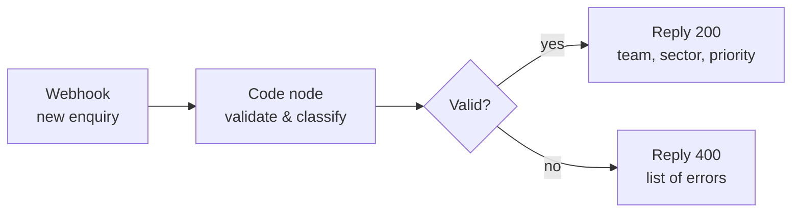

# n8n Lead Intake Automation

An n8n workflow that receives a customer enquiry, checks it, works out which sector and use case it is about, sets a priority and routes it to the right sales team, with a reply in under a second.

**[▶ Live demo](https://sachinisand.github.io/n8n-lead-intake-automation/demo/)** · [](https://github.com/Sachinisand/n8n-lead-intake-automation/actions/workflows/tests.yml)



## Demo

**[▶ Open the live demo](https://sachinisand.github.io/n8n-lead-intake-automation/demo/)** (runs in the browser, nothing to install). You can also download [`demo/index.html`](demo/index.html) and open it offline. It runs the same `classify.js` as the n8n Code node, so the answers match the workflow. Pick an example (hotel, warehouse, clinic, broken form) or type your own enquiry, and the page shows each workflow step and the reply.

## Why

Enquiries from a website form or email often land in one inbox and are sorted by hand. This workflow does the first sorting step automatically: incomplete enquiries are rejected with a clear reason, and valid ones arrive with a sector, a use case, a priority and the responsible team.

## Rules

| Step | Rule (German and English keywords) |
|---|---|
| Validation | name and message required, email must look valid; email is lower-cased |
| Sector | hospitality (hotel, restaurant, Gastronomie), retail (Einzelhandel, Supermarkt), logistics (Lager, warehouse), healthcare (Klinik, Pflege), otherwise "other" |
| Use case | cleaning (Reinigung), serving (Serviceroboter, Kellner), transport (Lieferung, Material) |
| Priority | **high**: asks for a quote/price **and** 50+ employees · **medium**: one of the two · **normal**: neither |
| Reply time | high 4 h, medium 24 h, normal 48 h |
| Team | Sales Hospitality / Retail / Logistics / Healthcare, otherwise Inside Sales |

## Run it

```bash
npx n8n            # or: docker run -it --rm -p 5678:5678 n8nio/n8n
```

1. Open http://localhost:5678, then **Workflows → Import from File** and choose `lead-intake-workflow.json`.
2. Activate the workflow.
3. Send an example enquiry (or see "Test inside n8n" below):

```bash
curl -X POST http://localhost:5678/webhook/lead-intake \
  -H "Content-Type: application/json" \
  --data @examples/hotel_quote.json
```

### Test inside n8n (no curl needed)

Open the **Webhook** node, choose **Set mock data** (pencil icon on the output side), paste the example wrapped in `body`, then click **Test workflow**:

```json
{"body": {"name": "Anna Becker", "company": "Hotel Seeblick GmbH", "email": "A.Becker@seeblick-hotel.de", "employees": 120, "message": "Wir suchen einen Serviceroboter für unser Restaurant und hätten gern ein Angebot."}}
```

Expected answers for the four examples (tested with n8n 1.123):

| Example | Answer |
|---|---|
| `hotel_quote.json` | 200 · Sales Hospitality · serving · **high** · reply within 4 h |
| `warehouse_cleaning.json` | 200 · Sales Logistics · cleaning · normal · 48 h |
| `clinic_info.json` | 200 · Sales Healthcare · transport · normal · 48 h |
| `invalid.json` | 400 · name missing, message missing, email invalid |

## Tests

The classification logic lives in `classify.js` and is copied into the Code node, so it can also be tested without n8n:

```bash
node tests/test_classify.mjs
node demo/build.mjs     # rebuild the browser demo after changing classify.js
```

GitHub Actions runs these checks on every push and also checks that the workflow file and the browser demo contain the current version of `classify.js`.

## Design decisions

- **Explainable keyword rules first.** Sales teams can see why an enquiry was routed somewhere and adjust the keywords. An AI classifier could be added later, with these rules as the fallback.
- **Reject early, with reasons.** A 400 reply lists every problem at once, so the form or the sender can fix them in one go.
- **One place for the logic.** The Code node and the tests use the same file, so they cannot drift apart.

## Next steps

- Write accepted leads to a CRM (for example Zoho CRM or HubSpot) and notify the team by email or Slack.
- Add an AI step (LLM) to classify free-text messages, keeping the keyword rules as a fallback.
- Track how many enquiries arrive per sector and priority each week.

## Limitations

- Keyword matching is simple: a message that mentions several sectors takes the first match, and unusual wording falls back to "other".
- The examples are invented test data, not real customer enquiries.

---

Built with the help of an AI coding assistant (Claude Code).

**Author:** Sachini Hewahattage · [LinkedIn](https://www.linkedin.com/in/sachini-hewahattage) · [GitHub](https://github.com/Sachinisand)
